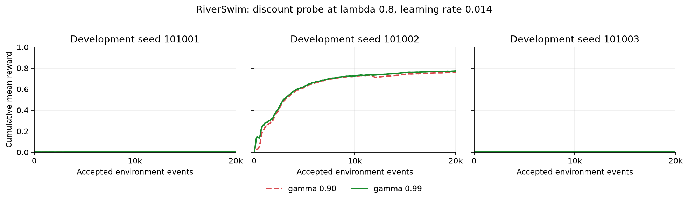

# RiverSwim discount-horizon probe

Completed bounded development panel: **`bounded_gamma_increase_inconclusive`**.
All six fresh-process full reference lives completed without retry, seed
substitution or partial comparison: 120,000 accepted/executed events.
Permanently nonpromoting; no control is selected or scientific evidence created.

## Question and fixed design

PR #3220 found two large gains from reducing trace learning rate, one seed near
the reward floor in every arm, and no passed lambda-specific interaction rule.
This probes a different factor: gamma 0.9 versus 0.99, with lambda 0.8 and
learning rate 0.014 fixed. Each arm is remeasured on fresh development seeds
101001–101003 for 20,000 full `ReferenceLifeRunner` transitions per seed.
No previous shard is reused as a baseline, and the old roster is consumed.

The default chain needs five net upstream moves. At lag 20 the discount weight
is approximately 0.122 versus 0.818; geometric discount scale is 10 versus 100.
This motivates testing longer-horizon learning, not a claim that gamma 0.9 has
the wrong optimal policy. Gamma also changes trace decay from approximately
0.72 to 0.792 and changes value/TD-error scale. The intervention measures their
combined effect. It cannot identify pure horizon mediation or separate trace
accumulation from stability. The learning rate is not rescaled again.

The [plan](plan.json), [run script](run.py) and [independent validator](validate.py)
were frozen in `b19b48f1428c108ab4baf416df32027069a313e3` and publicly opened in
[PR #3225](https://github.com/SlopDotCash/asi/pull/3225) at `2026-10-15T07:12:35Z` before every
comparison start. Plan, run and validator bytes remain unchanged. The saved
[public metadata](preregistration.json) binds that input commit and creation time.
Reported UTC times establish consistency, not independent execution attestation.

All default six-state RiverSwim, epsilon 0.5 to 0.02 over 2,500 steps, empty
hidden network, per-action shared biases, initialization and full exact-dispatch
runner settings stay fixed. Initial diagnostics match exactly within each pair.
Only gamma differs in actual configurations; canonical float32 values are saved.

## Primary results

Lifetime mean reward per transition. Each arm has three paired development
seeds; spreads are sample standard deviations, not confidence bounds.

| Arm | Lifetime mean reward +/- sample SD |
| --- | ---: |
| gamma_090 | 0.256317917 +/- 0.436617420 |
| gamma_099 | 0.260614667 +/- 0.443960648 |

| Seed | gamma 0.9 | gamma 0.99 | Paired delta |
| --- | ---: | ---: | ---: |
| 101001 | 0.004070750 | 0.004185000 | +0.000114250 |
| 101002 | 0.760480250 | 0.773256250 | +0.012776000 |
| 101003 | 0.004402750 | 0.004402750 | +0.000000000 |

Mean paired delta: **0.004296750 +/- 0.007343468**.
The frozen sign/size screen passed: **false**.
The stricter improvement rule passed: **false**.
The screen requires all three deltas strictly positive and mean above 0.01.
An improvement claim additionally requires mean above across-seed sample SD.
If mean is nonpositive the bounded result is negative; other nonqualifying
positive outcomes are inconclusive. No secondary or reference metric rescues it.

Seeds 101001 and 101003 observed no upstream reward under either gamma. Only
seed 101002 shows an appreciable benefit. The small positive mean is inside
the paired seed-to-seed spread; this panel does not support an improvement
claim or show that increasing gamma solves the observed discovery failures.



The curves are descriptive prefixes decimated every 100 events, not a new
selection metric. Generated by [plot.py](plot.py), Matplotlib 3.11.1.
[Vector export](reward-prefixes.svg).

## Fixed secondary diagnostics

`None` is no upstream reward before the fixed horizon, not event zero.
Rightmost visits count the post-transition state; rewards use prior state and
action. Action counts and every raw position/reward are retained in the shards.

| Seed | Arm | First upstream reward | Rightmost visits | Last-2000 mean | Parameter-change events |
| --- | --- | ---: | ---: | ---: | ---: |
| 101001 | gamma_090 | None | 0 | 0.004737500 | 20000 |
| 101001 | gamma_099 | None | 0 | 0.004737500 | 20000 |
| 101002 | gamma_090 | 45 | 15492 | 0.816500000 | 20000 |
| 101002 | gamma_099 | 45 | 15740 | 0.816500000 | 20000 |
| 101003 | gamma_090 | None | 0 | 0.004740000 | 20000 |
| 101003 | gamma_099 | None | 0 | 0.004740000 | 20000 |

Read-only snapshots at events 0, 100, 1000, 2500, 5000, 10000 and 20000 contain
action values by state/action, head eligibility L2 and max-absolute norms, and
parameter L2. Their shape and finite values are checked, not independently
replayed learner states or causal mediation evidence.

## Completeness, resources and verification

The fixed pair schedule used at most two CPU benchmark processes at once, with
OMP/OpenBLAS/MKL threads 1 and JAX preallocation false. No comparison failures,
retries, substitutions, early stopping or source drift occurred. Two separate
one-event [CLI preflights](preflight/) at excluded seed 101099 passed, with
matching initial diagnostics. The incomplete comparison roster was explicitly
rejected without producing a summary.

Agent numeric state endpoints are equal in every arm: 220 bytes, 55 elements,
23 leaves (17 floating). This excludes runner/environment objects and native
peak/process memory. Trace arithmetic is not free; update-attempt budgets are
equal but parameter-change events can differ. Timing is telemetry only.
Runtime: Windows AMD64, Python 3.12.4, JAX/jaxlib 0.11.0, NumPy 2.5.1,
Chex 0.1.92, CPU. Per-shard runtime and thread settings are retained.

All 228 framework/config/lockfile digests match the input commit's Git blobs,
the current source bytes and unchanged framework base
`415e7d225a4338492275be6cafa69d87c158c30a`. The independent validator checked every raw
reward/action/state row, reward lattice, transition support, complete counters,
resources, first upstream event, visits/actions, pairing, UTC schedule and all
aggregates. The retained summary re-derived byte for byte. See
[summary.json](summary.json) and [verification.json](verification.json).

Existing reference-control tests: 39 passed. Repository and retained-script
Ruff passed; mypy with `--platform linux` passed for 226 source files.
Evidence registry exit 2: all five statuses and error lists equal the saved
baseline. Full fast/scientific suites were not rerun for this evidence-only
Windows contribution. Checksums bind retained bytes, not authenticated execution.
No signed run or private trace is claimed.

## Reproduction

From the repository root, at the frozen input commit, with the fixed thread
environment above and new output paths outside the checkout:

```sh
python outputs/reference_life_control_calibration/discounted-sarsa-horizon-2026-10-15/run.py --seed 101001 --arm gamma_090 --out /new/path/gamma_090-seed101001.json
python outputs/reference_life_control_calibration/discounted-sarsa-horizon-2026-10-15/run.py --seed 101001 --arm gamma_099 --out /new/path/gamma_099-seed101001.json
```

Use every declared seed and the exact pair schedule; at most two fresh
processes. These already-consumed development seeds cannot become fresh
scientific evaluation. For complete retained-data recomputation:

```sh
python outputs/reference_life_control_calibration/discounted-sarsa-horizon-2026-10-15/validate.py --records outputs/reference_life_control_calibration/discounted-sarsa-horizon-2026-10-15 --inputs outputs/reference_life_control_calibration/discounted-sarsa-horizon-2026-10-15 --source-root . --preregistration outputs/reference_life_control_calibration/discounted-sarsa-horizon-2026-10-15/preregistration.json --out /new/path/recomputed-summary.json
```

## Limits

Three development seed pairs and two gamma values cannot establish optimality,
statistical confidence, general trace superiority, pure discount-horizon
mediation, sole causation of earlier failure, transfer/retention, frozen-scorecard
qualification, reference-dev selection or scientific evidence. No implementation,
prior artifact or frozen gate is changed. Any further tuning needs a different
bounded hypothesis, preregistration and fresh seeds; this completed plan cannot
be retuned after observation.
