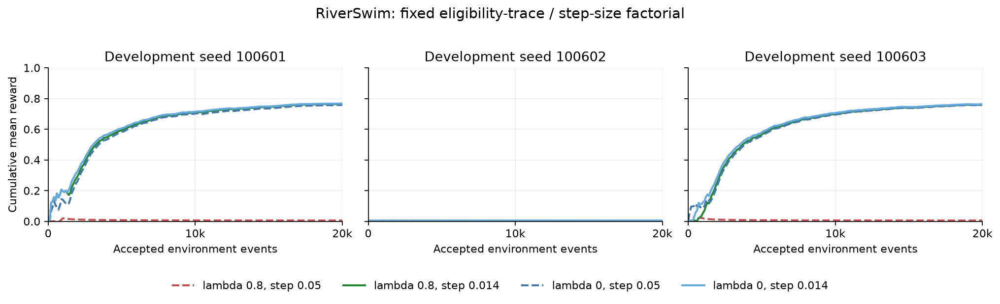

# RiverSwim eligibility-trace step-size probe

Completed permanently nonpromoting development factorial. Decision:
`bounded_trace_step_reduction_supported`. The prespecified fixed-lambda step-reduction rule passes in this bounded panel.
The separately fixed interaction rule does not pass. The panel does not establish a lambda-specific explanation of the earlier failure.
Three development seeds and sample standard deviations provide no confidence claim.
No reference configuration is selected and no scientific evidence is promoted.

## Question and prespecified design

PR #3218 found poor lifetime reward with `lamda=0.8` and `step_size=0.05`.
One arm discovered the upstream reward early yet later preferred the left reward.
This new experiment asks whether reducing step size helps at fixed lambda, and
whether that effect is larger with traces than without them.

Only two prespecified factors vary, with each contrast holding the other fixed:
`lamda` 0 or 0.8 and `step_size` 0.05 or 0.014. The smaller step was fixed as
`0.05 * (1 - 0.9 * 0.8)`. An accumulating scalar trace with repeated unit input
and decay approximately 0.72 has geometric scale approximately 1/(1-0.72).
This motivates one heuristic probe; varying features, shared biases and a
changing policy make it neither an optimality nor a stability guarantee.

The full [plan](plan.json) and [execution script](run.py) were committed at
`9b3565fe3aa9cc0155cd7573ec96d6d8fbf85275` and publicly opened as draft
[PR #3220](https://github.com/SlopDotCash/asi/pull/3220) before comparison execution.
The [saved preregistration metadata](preregistration.json) binds that commit and
the public creation time. Those plan/script bytes remain unchanged. Every
recorded UTC start follows that time. Times are self-reported consistency data.

All twelve fresh-process lives completed: four arms, three fresh development
seeds (100601-100603), 20,000 accepted/executed events per life, 240,000 total.
No old shard or scorecard/calibration seed is reused. All default six-state
RiverSwim, gamma 0.9, epsilon 0.5 to 0.02 over 2,500 steps, empty hidden network and
shared linear-head bias settings are fixed. Initial diagnostics match exactly
across all four arms within each seed. Actual float32 step sizes are retained
in every raw configuration. Full existing `ReferenceLifeRunner` execution and
strict keyed stochastic-transition validation are used for every event.

## Results

Each arm has three paired development seeds. Values are lifetime mean reward
per transition, reported as mean +/- sample standard deviation, not confidence
bounds.

| Arm | Lambda | Nominal step size | Mean reward +/- sample SD |
| --- | ---: | ---: | ---: |
| trace_original | 0.8 | 0.05 | 0.005339667 +/- 0.000441625 |
| trace_scaled | 0.8 | 0.014 | 0.509861250 +/- 0.437361466 |
| no_trace_original | 0.0 | 0.05 | 0.506944750 +/- 0.434851971 |
| no_trace_scaled | 0.0 | 0.014 | 0.512069750 +/- 0.439273533 |

| Seed | trace_original | trace_scaled | no_trace_original | no_trace_scaled |
| --- | ---: | ---: | ---: | ---: |
| 100601 | 0.005625250 | 0.764270500 | 0.757527000 | 0.767456000 |
| 100602 | 0.004831000 | 0.004844500 | 0.004821250 | 0.004844500 |
| 100603 | 0.005562750 | 0.760468750 | 0.758486000 | 0.763908750 |

The primary contrast is `trace_scaled - trace_original`. Support requires every
paired difference strictly positive and their mean above 0.01. The interaction
is `(trace_scaled - trace_original) - (no_trace_scaled - no_trace_original)`.
Its rule additionally requires the primary pass and every interaction strictly
positive with mean above 0.01. No reference or secondary metric can substitute.

| Seed | Trace step reduction | No-trace step reduction | Interaction |
| --- | ---: | ---: | ---: |
| 100601 | +0.758645250 | +0.009929000 | +0.748716250 |
| 100602 | +0.000013500 | +0.000023250 | -0.000009750 |
| 100603 | +0.754906000 | +0.005422750 | +0.749483250 |

Primary difference: **0.504521583 +/- 0.436920817**.
No-trace step difference: **0.005125000 +/- 0.004959583**.
Interaction: **0.499396583 +/- 0.432498742**.

The prespecified reference comparisons are descriptive checks, not selection:
`trace_scaled - no_trace_original` is
**0.002916500 +/- 0.003456061**; against `no_trace_scaled`
it is **-0.002208500 +/- 0.001916846**. Per-seed reference
differences are retained in [summary.json](summary.json). A calibration gain
does not by itself establish a stronger control or explain the old failure.

The descriptive cumulative reward curves below show two large improvements and
one seed where all four arms remain near the left-reward floor. These plots
add no decision metric. They were generated with [plot.py](plot.py),
Matplotlib 3.11.1, and visually checked.



Vector export: [reward-prefixes.svg](reward-prefixes.svg).

## Fixed secondary diagnostics

`None` means upstream reward was not observed before the fixed horizon, not
event zero. Rightmost visits count post-transition state; rewards use prior
state and selected action, so visit and reward counts differ.

| Seed | Arm | First upstream reward event | Rightmost visits | Last-2000 mean | Parameter-change events |
| --- | --- | ---: | ---: | ---: | ---: |
| 100601 | trace_original | 891 | 28 | 0.004917500 | 18636 |
| 100601 | trace_scaled | 150 | 15515 | 0.788500000 | 20000 |
| 100601 | no_trace_original | 178 | 15367 | 0.788500000 | 20000 |
| 100601 | no_trace_scaled | 150 | 15587 | 0.788500000 | 20000 |
| 100602 | trace_original | None | 0 | 0.004937500 | 18393 |
| 100602 | trace_scaled | None | 0 | 0.004937500 | 20000 |
| 100602 | no_trace_original | None | 0 | 0.004937500 | 20000 |
| 100602 | no_trace_scaled | None | 0 | 0.004937500 | 20000 |
| 100603 | trace_original | 340 | 23 | 0.004910000 | 19626 |
| 100603 | trace_scaled | 673 | 15422 | 0.808500000 | 20000 |
| 100603 | no_trace_original | 79 | 15386 | 0.808500000 | 20000 |
| 100603 | no_trace_scaled | 340 | 15509 | 0.808500000 | 20000 |

Raw records contain read-only action-value tables, head-eligibility L2 and
max-absolute norms, and parameter L2 at events 0, 100, 1000, 2500, 5000, 10000, 20000.
Stored head traces in the lambda-zero path are not all active update directions;
their norm cannot be interpreted as effective update amplitude. These snapshots
describe state evolution. They are checked for shape and finite values, not
independently replayed learner states or a causal mediation analysis.

## Resources, provenance and completeness

All comparison attempts succeeded in the fixed pair schedule, with no retry,
seed substitution, partial comparison or source drift. At most two independent
CPU shards were active at once. OMP/OpenBLAS/MKL threads were 1 and JAX
preallocation false. Four separately retained one-event [CLI preflights](preflight/)
at seed 100699 are excluded by schema, eligibility flag, directory and roster.

Initial and final control numeric payload is 220 bytes, 55 elements, 23 leaves
(17 floating leaves), equal in every arm. This excludes runner/environment
objects, host/container overhead and native peak memory. Trace computation is
not assumed free, parameter-change counts can differ despite equal event and
update-attempt budgets, and wall seconds are telemetry rather than a qualified
speed comparison.

Runtime: Windows AMD64, Python 3.12.4, JAX/jaxlib 0.11.0, NumPy 2.5.1, Chex 0.1.92,
CPU. Every shard records the same clean input commit and 228 framework/config/
lockfile byte digests. Those bytes match the frozen commit's Git blobs and the
unchanged framework base `415e7d225a4338492275be6cafa69d87c158c30a`.
No implementation, frozen gate, validator or prior artifact is changed.

## Reproduction and verification

From the repository root, use the project venv and fixed thread settings above:

```sh
python outputs/reference_life_control_calibration/discounted-sarsa-step-size-2026-10-15/run.py --seed 100601 --arm trace_original --out /new/path/trace_original-seed100601.json
python outputs/reference_life_control_calibration/discounted-sarsa-step-size-2026-10-15/run.py --seed 100601 --arm trace_scaled --out /new/path/trace_scaled-seed100601.json
```

Use all four arm names, every declared seed and the exact schedule in the plan,
fresh processes at the frozen input commit, new output paths outside the
checkout and at most two workers. The original roster is already consumed
development data. A replay cannot become fresh evaluation or scientific data.

The independent [validator](validate.py) checks the full 12-entry roster,
source/runtime/plan/script equality, canonical float32 factor values, all other
configuration equality, initial pairing, UTC order, counters, numeric-resource
endpoints, raw reward lattice, every transition's support, reward aggregates,
first upstream reward, visit/action counts and snapshot inventory. It computes
all arm means/spreads, per-seed contrasts, interaction and fixed decisions.
The incomplete roster was explicitly rejected without writing a summary.

```sh
python outputs/reference_life_control_calibration/discounted-sarsa-step-size-2026-10-15/validate.py --records outputs/reference_life_control_calibration/discounted-sarsa-step-size-2026-10-15 --inputs outputs/reference_life_control_calibration/discounted-sarsa-step-size-2026-10-15 --source-root . --preregistration outputs/reference_life_control_calibration/discounted-sarsa-step-size-2026-10-15/preregistration.json --out /new/path/recomputed-summary.json
```

The retained validator re-derived the summary byte for byte. Existing reference-control
tests passed (39); repository and retained-script Ruff passed; mypy with
`--platform linux` passed for 226 source files. The evidence registry exited 2:
all five statuses and error lists match the saved baseline. The full fast and
scientific suites were not rerun for this evidence-only Windows contribution.
The manifest covers the original input bytes, all 12 raw comparison records, four
excluded preflight records, summary, validator, metadata and report. Scoped
attributes prevent newline conversion. Hashes bind consistency rather than
authenticated execution. No signed run or private trace is claimed.

## Limits

Three development seed pairs and two prespecified step sizes cannot establish
the optimal step, statistical confidence, general SARSA superiority, sole
causation of prior failure, transfer or retention. This result never qualifies
the frozen scorecard, populates `reference-dev` or creates scientific evidence.
Any further tuning requires a new causal hypothesis, plan and fresh seeds;
the frozen gates and this completed plan cannot be retuned after observation.
